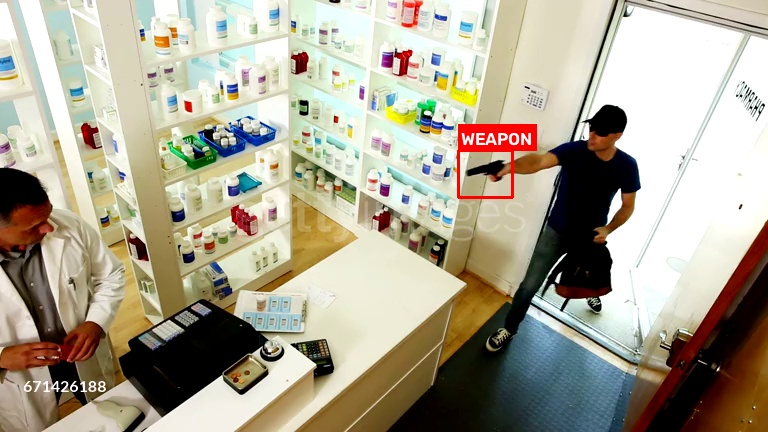
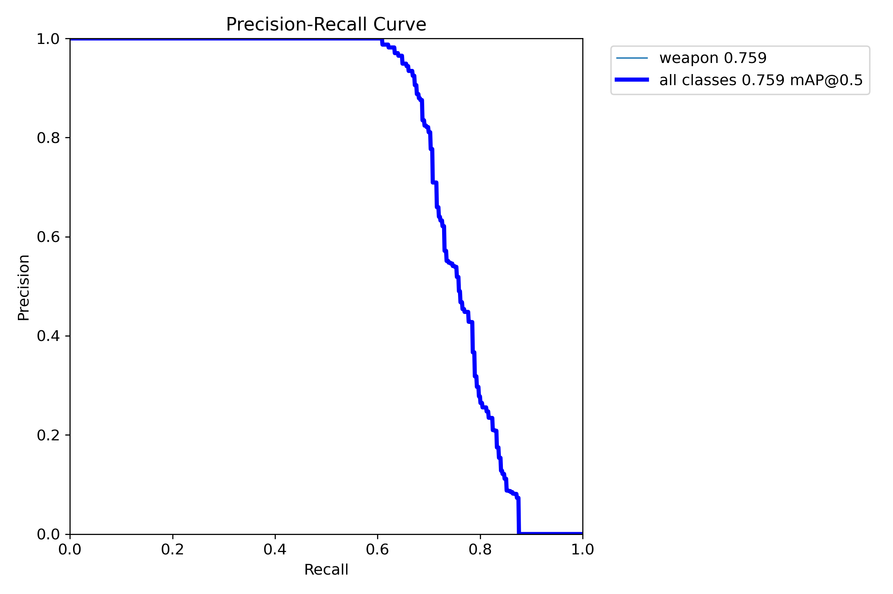
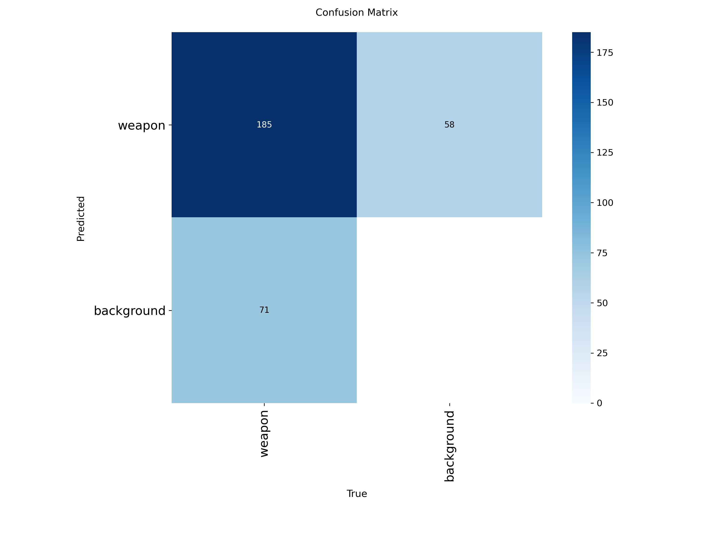

# weapon-detector

Real-time automated weapon detection pipeline designed for surveillance cameras and CCTV feeds, built using a fine-tuned YOLO11m architecture.



---

## Overview

Automated weapon detection in surveillance environments requires high precision to prevent false alarms while maintaining real-time frame rates. This project provides a complete, self-contained detection pipeline fine-tuned on a sanitized, single-class (`weapon`) dataset.

- **Architecture:** YOLO11m (Medium variant)
- **Parameters:** 20.05 Million
- **Computational Complexity:** 68.3 GFLOPs
- **Input Resolution:** 640 × 640
- **Primary Class:** `weapon` (unified handguns, rifles, shotguns, and knives)

---

## Benchmark Performance

Evaluated on held-out validation data across 60 training epochs:

| Metric | Score |
| :--- | :--- |
| **Precision (P)** | **94.3%** |
| **Recall (R)** | **66.0%** |
| **mAP@50** | **75.9%** |
| **mAP@50-95** | **47.7%** |
| **Inference Speed (NVIDIA RTX 3050)** | ~21.5 ms / frame (~46 FPS) |
| **Inference Speed (Tesla T4 GPU)** | ~14.4 ms / frame (~69 FPS) |

### Validation Curves & Confusion Matrix

| Precision-Recall Curve | Confusion Matrix |
| :---: | :---: |
|  |  |

---

## Repository Structure

```text
weapon-detector/
├── assets/
│   └── sample.jpg        # Unannotated test frame for quick verification
├── docs/
│   ├── demo_detection.jpg
│   ├── confusion_matrix.png
│   ├── pr_curve.png
│   └── training_results.png
├── src/
│   ├── __init__.py
│   └── detector.py       # Core WeaponDetector class
├── weights/
│   └── best.pt           # Fine-tuned YOLO11m weights (~38.6 MB)
├── detect.py             # CLI interface for webcam, video, and image inference
├── requirements.txt      # Python dependencies
├── .gitignore            # Security filters (blocks secrets, cache, temp media)
├── LICENSE               # MIT License
└── README.md
```

---

## Installation

### 1. Clone the repository
```bash
git clone https://github.com/apuravmanhas/weapon-detector.git
cd weapon-detector
```

### 2. Create and activate a virtual environment
```bash
# Windows
python -m venv venv
.\venv\Scripts\activate

# Linux / macOS
python3 -m venv venv
source venv/bin/activate
```

### 3. Install dependencies
```bash
pip install -r requirements.txt
```

---

## Usage

### 1. Quick Verification (Sample Image)
Run inference on the included sample image to verify your setup:
```bash
python detect.py --source assets/sample.jpg --save result.jpg
```

### 2. Live Webcam Feed
Runs real-time detection on your default camera:
```bash
python detect.py --source 0
```
*Note for Windows users:* The script automatically selects the `DirectShow` backend to avoid camera initialization freezes.

### 3. Video File
Process a recorded CCTV or video clip and save the annotated output:
```bash
python detect.py --source input_cctv.mp4 --save output_annotated.mp4
```

---

## CLI Options

| Argument | Type | Default | Description |
| :--- | :---: | :---: | :--- |
| `--source` | `str` | `0` | Camera index (`0`), video path, or image path. |
| `--weights` | `str` | `weights/best.pt` | Path to model weights file. |
| `--conf` | `float` | `0.40` | Minimum confidence threshold for detection. |
| `--show-conf` | `flag` | `False` | Display confidence score on bounding boxes. |
| `--save` | `str` | `None` | Path to save annotated output image/video. |
| `--no-show` | `flag` | `False` | Run in headless mode without preview window. |
| `--device` | `str` | `None` | Device selection (`cuda:0`, `cpu`, or auto). |

---

## Security & Privacy Safeguards

- **Zero External Telemetry:** All inference executes locally on your hardware. No video frames, images, or metrics are uploaded or transmitted externally.
- **No Hardcoded Secrets:** This repository contains no API keys, private tokens, or personal identifiers.
- **Git Protection:** `.gitignore` is configured to prevent accidental commits of `.env` files, credentials, local training logs, and recorded media.

---

## License

This project is licensed under the [MIT License](LICENSE).
