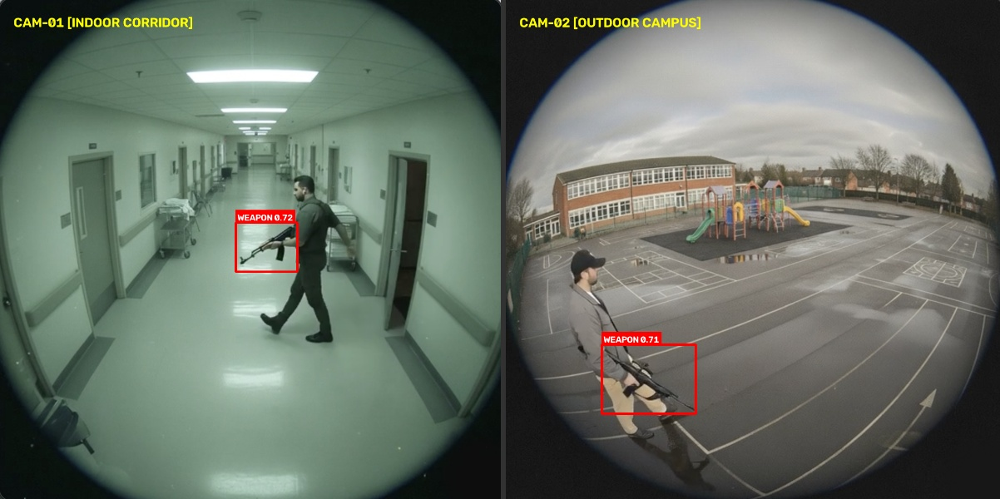
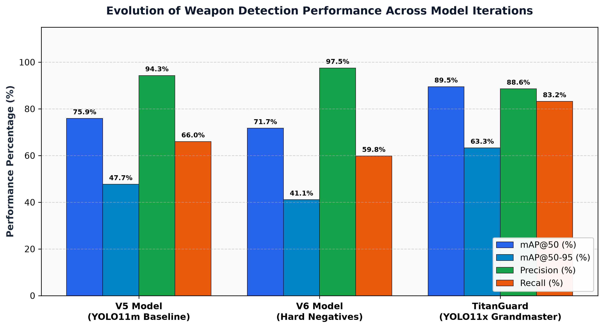

# weapon-detector

Real-time automated weapon detection pipeline for CCTV and surveillance video streams, powered by fine-tuned Ultralytics YOLO11 architectures.



---

## Overview

Automated surveillance weapon detection requires high detection recall on small, partially occluded threats while eliminating false alarms from everyday metallic items (phones, power tools, wallets). 

This repository provides two pre-trained model variants fine-tuned on consolidated surveillance datasets:
1. **YOLO11x Production Model** (Default): 56.96M parameters, trained on 37,641 high-security surveillance frames with hard-negative mining.
2. **YOLO11m Baseline Model**: 20.05M parameters, lightweight variant optimized for edge or low-compute devices.

Both models enforce a unified single-class surveillance taxonomy (`{0: 'weapon'}`) covering handguns, assault rifles, shotguns, and bladed weapons.

---

## Model Zoo & Benchmark Performance

Evaluated on held-out validation sets across standard COCO evaluation metrics:

| Model Variant | Weights File | Parameters | GFLOPs | Precision | Recall | mAP@50 | mAP@50-95 | GPU Inference (RTX 3050) |
| :--- | :--- | :---: | :---: | :---: | :---: | :---: | :---: | :---: |
| **YOLO11x (Production)** | `weights/yolo11x_weapon_production.pt` | **56.96M** | 194.5 | 88.6% | **83.2%** | **89.5%** | **63.3%** | ~15.5 ms (64.5 FPS) |
| **YOLO11m (Baseline)** | `weights/best.pt` | 20.05M | 68.3 | **94.3%** | 66.0% | 75.9% | 47.7% | ~21.5 ms (46.5 FPS) |



### Key Improvements in YOLO11x
- **+13.6% mAP@50** (89.5% vs. 75.9%) and **+15.6% mAP@50-95** (63.3% vs. 47.7%).
- **+17.2% Recall** (83.2% vs. 66.0%): Substantially reduces missed detections of concealed or low-contrast firearms in surveillance footage.
- **Hard-Negative Mining**: 1,634 background frames containing mobile phones, wallets, power tools, and metallic utensils to suppress false positives in high-risk zones.

---

## Repository Structure

```text
weapon-detector/
├── .gitattributes          # Git LFS configuration for large model weights
├── assets/
│   └── sample.jpg          # Unannotated sample frame for verification
├── docs/
│   ├── cctv_surveillance_preview.jpg
│   ├── model_comparison.png
│   ├── confusion_matrix.png
│   ├── pr_curve.png
│   └── training_results.png
├── src/
│   ├── __init__.py
│   └── detector.py         # Core WeaponDetector class
├── weights/
│   ├── yolo11x_weapon_production.pt  # Production YOLO11x weights (114.5 MB, Git LFS)
│   └── best.pt                       # Baseline YOLO11m weights (38.6 MB)
├── detect.py               # CLI interface for webcam, video, and image inference
├── requirements.txt        # Python package dependencies
├── .gitignore              # Ignores credentials, caches, and test media
├── LICENSE                 # MIT License
└── README.md
```

---

## Installation

### Prerequisites
- Python 3.9+
- [Git LFS](https://git-lfs.com/) (required to pull the 114.5 MB production model weights)

### 1. Clone the repository and pull LFS weights
```bash
git clone https://github.com/apuravmanhas/weapon-detector.git
cd weapon-detector
git lfs pull
```

### 2. Create and activate a virtual environment
```bash
# Linux / macOS
python3 -m venv venv
source venv/bin/activate

# Windows (PowerShell)
python -m venv venv
.\venv\Scripts\Activate.ps1
```

### 3. Install dependencies
```bash
pip install -r requirements.txt
```

---

## Usage

### 1. Test Single Image
Run inference on an image and save the annotated output:
```bash
python detect.py --source assets/sample.jpg --save result.jpg
```

### 2. Real-Time Camera Stream
Run detection on your connected webcam or camera feed:
```bash
python detect.py --source 0
```
*Note for Windows users:* The CLI automatically probes `DirectShow` (`CAP_DSHOW`) and `MSMF` backends to prevent camera capture freezing.

### 3. Recorded Video / CCTV Stream
Process a video clip and export the annotated stream:
```bash
python detect.py --source input_cctv.mp4 --save output_annotated.mp4
```

### 4. Switch Models and Resolution
By default, `detect.py` loads the production YOLO11x model if present. To manually specify weights or increase spatial resolution for distant targets:

```bash
# Run with YOLO11x at 800x800 resolution for long-range CCTV cameras
python detect.py --weights weights/yolo11x_weapon_production.pt --imgsz 800 --source input_cctv.mp4

# Run with lightweight YOLO11m baseline
python detect.py --weights weights/best.pt --imgsz 640 --source 0
```

---

## CLI Options

| Argument | Type | Default | Description |
| :--- | :---: | :---: | :--- |
| `--source` | `str` | `0` | Camera device index (`0`), video path, or image path. |
| `--weights` | `str` | Auto-detect | Path to `.pt` weights (defaults to YOLO11x if present, else YOLO11m). |
| `--conf` | `float` | `0.35` | Minimum confidence score threshold for detection. |
| `--imgsz` | `int` | `640` | Inference input resolution (`640` or `800` for high accuracy). |
| `--show-conf` | `flag` | `False` | Display confidence score badges on bounding boxes. |
| `--save` | `str` | `None` | Output file path to save annotated image or video. |
| `--no-show` | `flag` | `False` | Run in headless mode without a preview GUI window. |
| `--device` | `str` | `None` | Compute device (`cuda:0`, `cpu`, or auto-detect). |

---

## Security & Privacy Safeguards

- **100% On-Premise Execution:** All inference runs locally on the host machine. No frames, video streams, or telemetry data are transmitted externally.
- **No Hardcoded Credentials:** Zero API keys, authentication tokens, or personal identifiers exist in this codebase.
- **Repository Integrity:** `.gitignore` blocks `.env` files, credential dumps, local test videos, and model training artifacts.

---

## License

This project is open-source and licensed under the [MIT License](LICENSE).
